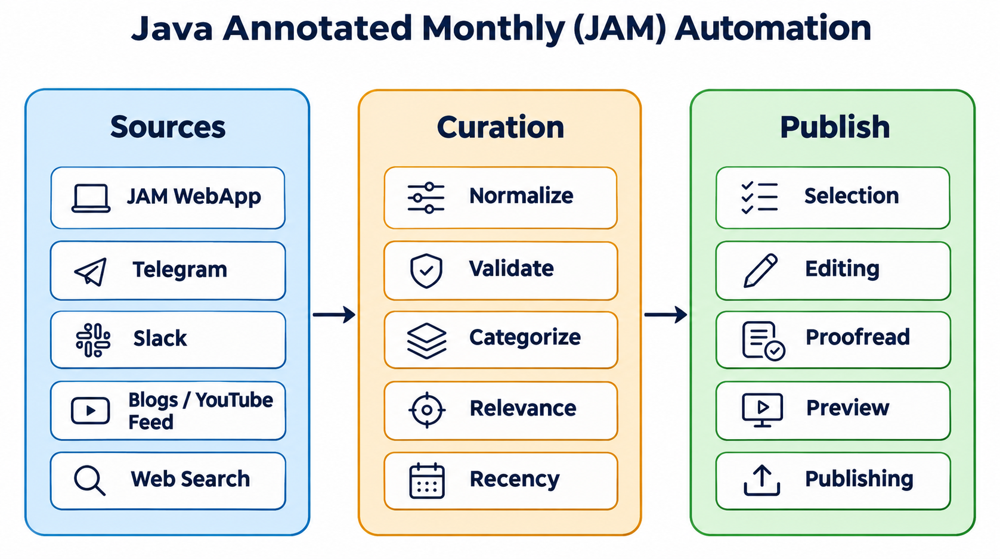
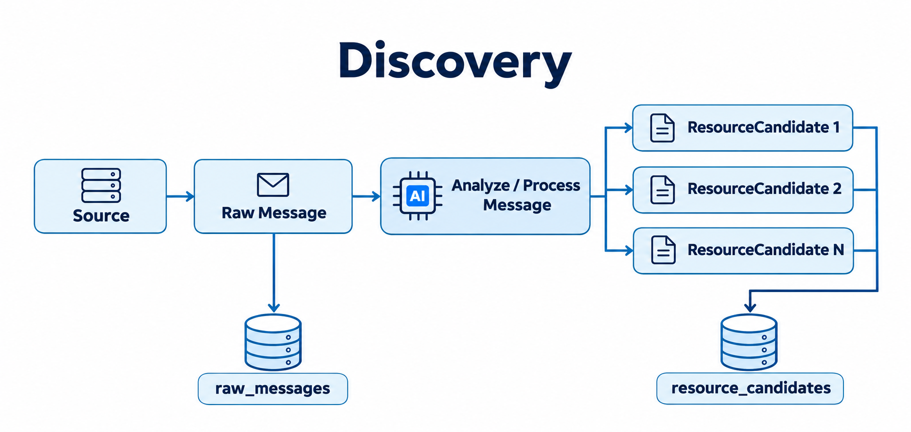
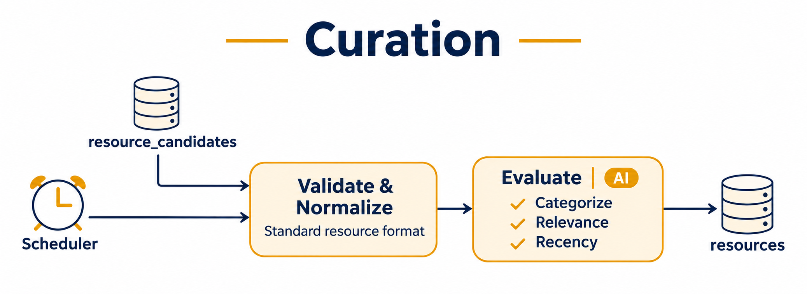
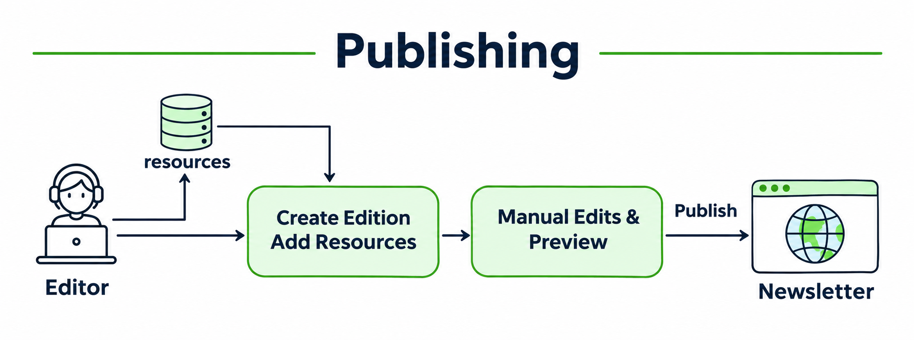

# JAM Automation
Java Annotated Monthly (JAM) Automation system that:
- Discovers JVM related published information from various sources
- Curate the gathered resources by verifying relevancy and recency.
- Select, edit and generate monthly annotated reports.



## Prerequisites
* JDK 25
* [mise](https://mise.jdx.dev/)
* [Docker and Docker Compose](https://docs.docker.com/desktop/)
* [Ollama](https://ollama.com/) or [OpenAI API Key](https://platform.openai.com/)

This application uses [Spring AI](https://docs.spring.io/spring-ai/reference/) with the following chat model providers:
* **Ollama** (`ollama`) - runs locally.
* **OpenAI** (`openai`) - set the `OPENAI_API_KEY` environment variable.

The active chat model is selected by the `spring.ai.model.chat` property (default: `ollama`).
To switch providers, set the `SPRING_AI_MODEL_CHAT` environment variable to one of: `ollama`, `openai`.

## Using mise

[mise](https://mise.jdx.dev/) can install the required SDKs (Java, Maven) and run tasks defined in `mise.toml`.

```shell
# Trust the project's mise.toml (one-time)
$ mise trust

# Install the SDKs (Java 25 Temurin, Maven)
$ mise install

# List available tasks
$ mise tasks

# Format code and run tests
$ mise run format
$ mise run test

# Run verification checks
$ mise run verify

# Build docker image
$ mise run build_image

# Run application in docker container
$ mise run start
$ mise run stop
$ mise run restart
```

## JAM Workflow

### Discovery


1. Raw messages are fetched from the configured sources and stored in `raw_messages`.
2. AI analyzes and processes each message to extract one or more resource candidates.
3. The extracted candidates are stored in `resource_candidates`.

### Curation


1. A scheduler picks up pending entries from `resource_candidates`.
2. Each candidate is validated and normalized into a standard resource format.
3. AI evaluates the resource: it assigns a category and checks relevance and recency.
4. Evaluated resources are stored in `resources`.

### Publishing


1. An editor creates a new edition and adds resources to it from `resources`. Editors can also add resources manually.
2. The editor makes manual edits if required and previews the edition.
3. The edition is published as the newsletter.
